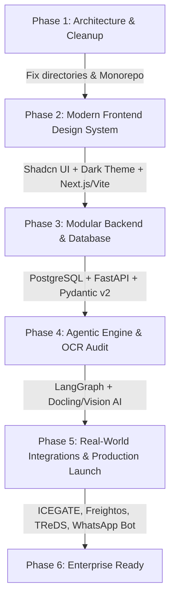

# 🚢 ExportEase AI — Feature Expansion Roadmap & Modern Tech Stack Migration Guide

> **Document Purpose**: This document provides an exhaustive breakdown of high-impact features that can be added to **ExportEase AI**, along with a **copy-pasteable Master AI Engineering Prompt** to revamp the entire UI, clean up repository debt, and modernize the tech stack into an enterprise-grade platform.

---

## 📑 Table of Contents
1. [Current State & Architecture Analysis](#1-current-state--architecture-analysis)
2. [High-Impact Feature Proposals (What Can Be Added)](#2-high-impact-feature-proposals-what-can-be-added)
   - [Tier 1: Government & Regulatory Integrations](#tier-1-government--regulatory-integrations-india--global)
   - [Tier 2: Computer Vision & Automated Document Audit](#tier-2-computer-vision--automated-document-audit)
   - [Tier 3: Multi-Agent Orchestration & Workflow Automation](#tier-3-multi-agent-orchestration--workflow-automation)
   - [Tier 4: Dynamic Freight, Multi-Modal Route & Carbon Tracker (CBAM)](#tier-4-dynamic-freight-multi-modal-route--carbon-tracker-cbam)
   - [Tier 5: Trade Finance, Forex Auto-Hedging & ECGC Insurance](#tier-5-trade-finance-forex-auto-hedging--ecgc-insurance)
   - [Tier 6: Voice-First, Multilingual WhatsApp Bot for MSMEs](#tier-6-voice-first-multilingual-whatsapp-bot-for-msmes)
   - [Tier 7: Verified Buyer Scoring & B2B Matchmaking Engine](#tier-7-verified-buyer-scoring--b2b-matchmaking-engine)
   - [Tier 8: Regulatory Change Radar & Real-Time Tariff Alerts](#tier-8-regulatory-change-radar--real-time-tariff-alerts)
3. [Proposed Modern Tech Stack & Architecture Overhaul](#3-proposed-modern-tech-stack--architecture-overhaul)
4. [Master Prompt to Revamp Entire UI & Tech Stack](#4-master-prompt-to-revamp-entire-ui--tech-stack)

---

## 1. Current State & Architecture Analysis

### Current Implementation Strengths
- **Vision & Scope**: Broad conceptual coverage of the cross-border export lifecycle (HS classification, compliance check, buyer discovery, document generation, trade routes).
- **Interactive 3D Visualizer**: Three.js Blue Marble globe showing trade corridor arcs.
- **RAG & Tool Layer**: LangChain + Groq (Llama 3.3 70B) + ChromaDB vector search + MCP tool definitions in `mcp_tools.py`.

### Identified Pain Points & Technical Debt
1. **Messy Folder Hierarchy**: UI is nested 3 levels deep: `backend/ExportEase UI (2)/ExportEase UI/ExportEase UI/`.
2. **Mock Data Heavy**: Pages like `BuyerDiscovery.jsx`, `ShipmentTracking.jsx`, `DemandForecast.jsx`, and `CurrencyRisk.jsx` utilize static client-side JSON mocks rather than dynamic live feeds or connected databases.
3. **Monolithic Tool Script**: `mcp_tools.py` contains hardcoded dictionary entries rather than scalable relational or vector database lookups.
4. **Missing Production Infrastructure**: Lack of persistent database (PostgreSQL/Supabase), auth session handling (JWT/OAuth2), job queue for long-running document generation (Celery/BullMQ), and end-to-end type safety (TypeScript).

---

## 2. High-Impact Feature Proposals (What Can Be Added)

### Tier 1: Government & Regulatory Integrations (India & Global)
* **ICEGATE 2.0 & DGFT EDI API Bridge**:
  - Direct integration with Indian Customs Electronic Gateway (ICEGATE) to automate Shipping Bill filing, IGST export refund status checking, and e-BRC (Bank Realisation Certificate) tracking.
  - Automatic validation of IEC (Importer-Exporter Code), AD Code (Authorized Dealer Code), and GSTIN compliance.
* **National Single Window System (NSWS) Integration**:
  - Unified clearance gateway connecting DGFT, APEDA, Spices Board, Coffee Board, CDSCO, and FSSAI.
* **Global Customs Tariff APIs**:
  - Connect with US ITC (Harmonized Tariff Schedule), EU TARIC database, and UK Trade Tariff API for real-time MFN (Most Favored Nation) and preferential tariff schedules under CEPA, ECTA, DCTS, and GSP.

### Tier 2: Computer Vision & Automated Document Audit
* **Zero-Error Document Discrepancy Engine**:
  - Exporters frequently suffer payment delays due to discrepancy between the Letter of Credit (LC), Commercial Invoice, Packing List, and Bill of Lading (B/L).
  - Add an OCR/Document AI pipeline (using Google Cloud Document AI, AWS Textract, or LayoutLM) to scan uploaded PDFs/images, cross-verify all 25+ fields (HS codes, gross/net weights, consignee address, Incoterms), and flag inconsistencies before customs submission.
* **Automated Digitally Signed Export Pack Generation**:
  - Generate pixel-perfect, compliant PDFs for:
    - Commercial Invoice & Packing List (DGFT standard format)
    - Certificate of Origin (COO / Non-Preferential & Preferential e-COO)
    - Shipping Bill (Form SB-I through SB-V)
    - Letter of Undertaking (LUT for IGST-free export under Rule 96A)
  - Integration with Aadhaar eSign / Class-3 Digital Signature Certificates (DSC).

### Tier 3: Multi-Agent Orchestration & Workflow Automation
* **LangGraph / CrewAI Agentic Pipeline**:
  - Transition from basic ReAct agents to a stateful multi-agent DAG (Directed Acyclic Graph):
    1. **Intake Agent**: Parses invoice or raw product specification.
    2. **ITC-HS Classifier Agent**: Dissects chemical/material composition to pinpoint the exact 8-digit ITC-HS code with confidence scoring.
    3. **Tariff & FTA Optimization Agent**: Calculates landed duty under competing trade agreements to recommend the most cost-effective export corridor.
    4. **SPS & TBT Compliance Agent**: Validates Sanitary and Phytosanitary (SPS) measures and Technical Barriers to Trade (TBT) mandatory certifications.
    5. **Sanctions & AML Screener**: Real-time screening against OFAC, EU Sanctions, UN Consolidated List, and FATF blacklists.
    6. **Document Synthesis Agent**: Populates official customs forms.
    7. **Audit & Review Agent**: Flags missing fields or high-risk discrepancies.

### Tier 4: Dynamic Freight, Multi-Modal Route & Carbon Tracker (CBAM)
* **Live Freight Pricing & Capacity Simulator**:
  - Real-time spot and contract rate comparisons: Air Freight vs. Ocean FCL (20ft/40ft/Reefer) vs. Ocean LCL vs. Inland Rail ICDs (Inland Container Depots).
  - Integrations with Freightos, Xeneta, or Flexport APIs.
* **EU CBAM (Carbon Border Adjustment Mechanism) Calculator**:
  - Mandatory carbon reporting for steel, aluminum, cement, fertilizers, and hydrogen exports to the European Union.
  - Compute embedded greenhouse gas emissions per ton of exported product and calculate estimated CBAM certificate costs.
* **Live AIS Vessel & Container Tracking**:
  - Live satellite AIS tracking of container ships via MarineTraffic or AISHub.
  - Port congestion telemetry (turnaround times at JNPT, Mundra, Rotterdam, Singapore, Jebel Ali).

### Tier 5: Trade Finance, Forex Auto-Hedging & ECGC Insurance
* **TReDS & Invoice Factoring Gateway**:
  - Direct integration with RBI-regulated TReDS platforms (RXIL, M1xchange, Invoicemart) allowing MSMEs to auction export receivables and obtain upfront working capital.
* **Real-time FX Hedging Recommendations**:
  - Live FX streaming (USD/INR, EUR/INR, GBP/INR, AED/INR).
  - Real-time Forward Contract & Options hedging calculator based on RBI EDPMS/IDPMS rules to protect export profit margins from currency fluctuations.
* **ECGC (Export Credit Guarantee Corporation) Premium Estimator**:
  - Credit risk insurance assessment for overseas buyers, calculating country risk ratings and insurance cover premium.

### Tier 6: Voice-First, Multilingual WhatsApp Bot for MSMEs
* **WhatsApp Conversational Agent**:
  - Enable non-tech-savvy regional exporters (textile weavers in Surat, brassware artisans in Moradabad, spice farmers in Guntur) to query trade policies, check HS codes, or get duty calculations via WhatsApp.
  - Support multi-modal inputs: send photo of product or invoice -> receive HS code and checklist.
* **Indic Voice AI**:
  - Speech-to-Text and Text-to-Speech in 10+ Indian languages (Hindi, Tamil, Telugu, Gujarati, Marathi, Bengali, Kannada) using Bhashini or ElevenLabs.

### Tier 7: Verified Buyer Scoring & B2B Matchmaking Engine
* **Dun & Bradstreet / Trade Credit Solvency Rating**:
  - Replace static buyer mockups with legitimate customs manifest analytics (Panjiva, ImportGenius style trade intelligence).
  - Assess buyer historical purchase volume, frequency, port of entry, and payment default risk.
* **Direct Buyer RFP & Quote Portal**:
  - Secure communication channel allowing Indian suppliers to submit quotations, share lab test reports, and negotiate Incoterms (FOB, CIF, DDP) directly.

### Tier 8: Regulatory Change Radar & Real-Time Tariff Alerts
* **Autonomous DGFT/CBIC Web Scraper & Change Detection**:
  - Background worker scanning DGFT Public Notices, CBIC Circulars, and Directorate General of Trade Remedies (DGTR) daily.
  - Send instant push/email alerts when minimum export prices (MEP), export duties, or export bans are updated on watched HS codes (e.g. rice, onion, sugar, steel).

---

## 3. Proposed Modern Tech Stack & Architecture Overhaul

| Tier | Current Tech Stack | Proposed Modern Tech Stack | Benefits & Rationale |
| :--- | :--- | :--- | :--- |
| **Monorepo / Folder Structure** | Deeply nested folders with broken paths | **Clean Monorepo**: `apps/web` (Frontend), `apps/api` (Backend), `packages/shared` | Clean developer ergonomics, easy CI/CD, single command startup. |
| **Frontend Framework** | React 19 + Vite (pure client-side) | **Next.js 15 (App Router)** or **Vite + React 19 + TanStack Router** | Server-side rendering (SSR) for market intelligence SEO, edge caching, streaming UI. |
| **Language** | Plain JavaScript (JSX) | **TypeScript 5.x** across the entire codebase | End-to-end type safety from backend schemas to UI components. |
| **UI Design System** | Custom Vanilla CSS + Tailwind v4 mixed | **Tailwind CSS v4 + Shadcn UI + Radix UI + Lucide Icons** | Ultra-polished enterprise grade UI, accessible components, beautiful dark/light themes. |
| **3D & Map Visualization** | Three.js blue marble sphere | **Deck.gl + Mapbox GL / MapLibre** or **Three.js R3F optimized** | Hardware-accelerated global geospatial shipping corridors, port telemetry, vessel tracking. |
| **Backend Framework** | FastAPI (single script) | **FastAPI (Modular Router Architecture)** + **Pydantic v2** | High-performance async Python backend with clean modular domains (`/api/v1/hs-code`, `/api/v1/compliance`, etc.). |
| **AI Agent Mesh** | Single ReAct agent in LangChain | **LangGraph / CrewAI** with persistent state | Stateful multi-agent workflow with human-in-the-loop approvals and checkpointing. |
| **Database & Vector DB** | Local file ChromaDB (no relational DB) | **PostgreSQL (Supabase) + pgvector** | Unified relational data (users, shipments, invoices) and vector embeddings in one managed DB. |
| **Task Queue & Workers** | Synchronous requests | **Celery / Temporal / Redis** | Async processing for PDF generation, bulk OCR document audits, web scraping alerts. |
| **Document Processing** | Simple regex / mock | **Docling / Unstructured.io / Tesseract / Claude 3.5 Sonnet Vision** | State-of-the-art PDF/Image extraction and schema validation. |

---

## 4. Master Prompt to Revamp Entire UI & Tech Stack

Copy and use the following master prompt in an AI coding assistant (like Antigravity, Claude Code, or Cursor) to execute the complete transformation:

````markdown
```text
You are an expert Principal Full-Stack Architect and Lead UI/UX Designer specializing in enterprise FinTech, TradeTech, and Global Supply Chain software.

Your mission is to completely redesign, refactor, and modernize the "ExportEase AI" project into an elite, production-ready Global Export Operating System named "ExportEase Enterprise".

### 1. REPOSITORY REORGANIZATION & CLEANUP
- Eradicate the deeply nested folder structure (`backend/ExportEase UI (2)/ExportEase UI/ExportEase UI`).
- Establish a clean, professional monorepo layout:
  /
  ├── apps/
  │   ├── web/                     # Modern Frontend (Next.js 15 or Vite + React 19 + TypeScript)
  │   └── api/                     # Modular FastAPI Backend (Python 3.11+)
  ├── packages/
  │   └── shared-types/            # Shared TypeScript/Pydantic data models
  ├── docker-compose.yml           # One-command spin up (Frontend, Backend, PostgreSQL, Redis)
  └── README.md                    # Professional documentation with architecture diagrams

### 2. MODERN UI/UX REDESIGN (AESTHETIC EXCELLENCE)
- Design Philosophy: "Palantir Foundry meets Linear & Stripe" — sleek, high-density, authoritative, and visually breathtaking.
- Color Palette: Deep obsidian/slate dark mode (`#0B0F19`), rich indigo accents (`#4F46E5`), emerald compliance green (`#10B981`), amber warning, and crisp neutral typography (Outfit or Inter font).
- Component Library: Integrate Shadcn UI (Radix primitives) + Tailwind CSS + Framer Motion.
- Core Views to Build/Refactor:
  1. Executive Command Center: Live KPI widgets, active export pipelines, foreign exchange risk radar, recent customs alerts.
  2. Global Logistics & Trade Corridors: High-performance 3D or 2.5D geospatial visualization showing route transit times, choke-points (Suez/Panama/Red Sea risk), and duty rate differentials.
  3. Smart ITC-HS Classifier & Tariff Engine: Instant multi-attribute search with landed cost calculators across FTAs (India-UAE CEPA, Australia ECTA, EU GSP).
  4. Document Discrepancy & Generator Studio: Drag-and-drop OCR audit that validates Commercial Invoice vs Packing List vs Bill of Lading, highlighting discrepancies in red/amber with instant one-click fixes and PDF export.
  5. Multi-Agent Co-Pilot & Workflow Trace: Real-time visual timeline showing autonomous agents executing compliance, sanction screening, and buyer verification steps with streaming thought logs.
  6. Verified Buyer & Market Intelligence Hub: Interactive trade volume analytics, importer solvency trust scores, and RFP quotation pipeline.

### 3. BACKEND MODULARIZATION & ARCHITECTURE
- Refactor the backend into clean domain modules inside `apps/api/`:
  - `api/routers/hs_code.py` — HS Code classification with semantic search and tree traversal
  - `api/routers/compliance.py` — Statutory requirement rules engine (DGFT, FSSAI, APEDA, FDA, CE)
  - `api/routers/documents.py` — PDF generation & OCR discrepancy audit engine
  - `api/routers/buyers.py` — Global buyer discovery and credit rating endpoints
  - `api/routers/forex.py` — Live exchange rates & forward contract hedging calculations
  - `api/routers/copilot.py` — SSE streaming multi-agent orchestrator
- Multi-Agent Orchestration: Build a resilient LangGraph / stateful workflow connecting:
  - Classification Agent -> Compliance Agent -> Sanctions Agent -> Document Agent.
- Database: Configure SQLAlchemy / SQLModel with PostgreSQL and pgvector for persistent documents, shipments, and vector search.
- Background Tasks: Implement Celery/Redis for long-running document generation and continuous DGFT notification scraping.

### 4. DELIVERABLES & EXECUTION STEPS
1. Step 1: Provide the new directory structure and clean up migration plan.
2. Step 2: Implement the core frontend design system, AppShell, Sidebar, TopBar, and Navigation.
3. Step 3: Implement the modular FastAPI backend with strict Pydantic schemas.
4. Step 4: Wire the frontend to backend endpoints using TanStack Query / async fetch with real-time SSE streaming for the Copilot.
5. Step 5: Deliver a one-click `docker-compose.yml` or `start.bat` script to run the entire unified stack locally with zero configuration hassle.
```
````

---

## 5. Quick Reference & Recommended Implementation Milestones



*File created and maintained in project workspace.*
