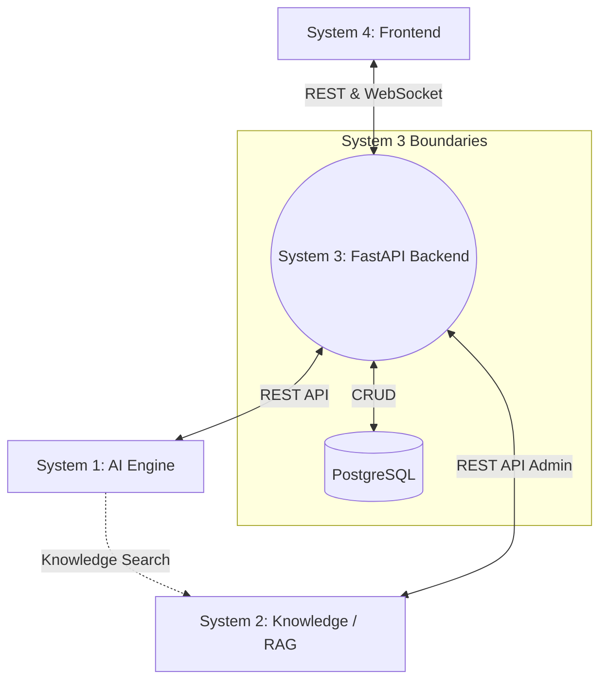

# ExportEase AI - Backend Architecture

## Overview
The ExportEase AI Backend is designated as **System 3 (EXPORT-EASE-BACKEND-V1)**. It acts as the central **Business Orchestrator** for the platform, binding together the intuitive Frontend (System 4), the AI Engine (System 1), and the Knowledge/RAG service (System 2). 

It is designed to model the actual **Indian MSME export process**, not just function as a conversational chatbot. It strictly governs workflow state, user and business contexts, and export compliance protocols while ensuring the AI respects grounded, verified knowledge.

## Core Objective
To seamlessly bridge Fast API logic, PostgreSQL persistence, AI reasoning capabilities, and compliance evidence retrieved from RAG. The golden rule is: **RAG for Regulatory Facts, AI for reasoning, Backend for state and safety.**

## High-Level Data Flow


## Folder Structure
```text
backend/
├── app/
│   ├── main.py........... # FastAPI entrypoint
│   ├── core/............. # App config, settings, and constants
│   ├── api/.............. # Router definitions and HTTP handlers
│   ├── models/........... # SQLAlchemy declarative models (DB Tables)
│   ├── schemas/.......... # Pydantic data contracts (Req/Res)
│   ├── repositories/..... # Layer abstracting direct DB queries (optional/merged with services)
│   ├── services/......... # Business logic, workflow engine, external orchestrations
│   ├── workflows/........ # Export procedure workflow state definitions
│   ├── auth/............. # JWT issuance and validation logic
│   ├── integrations/..... # HTTP Clients connecting to AI (System 1) and RAG (System 2)
│   └── utils/............ # Helpers, parsing, logging
├── migrations/........... # Alembic database migrations
├── seed/................. # Bootstrapping demo/base data
├── tests/................ # Pytest integration and unit tests
└── scripts/.............. # Admin tools and execution tasks
```

## System Responsibilities
1. **User Identity & Context**: Authenticates users (MSMEs vs. Admins) and maintains their business profiles (IEC, GSTIN).
2. **Export Projects**: Creates "Export Projects" tracking specific configurations (e.g., Turmeric powder to Germany).
3. **Workflow Engine**: Holds the absolute state for the 10-step export journey, ensuring sequential progression and gating progression based on required evidence.
4. **Agent Orchestration**: Delegates reasoning tasks (HS Classification, Compliance Mapping, Risk) to the AI engine by supplying localized context.
5. **Persistence**: Owns PostgreSQL and writes the results of AI evaluations and knowledge citations securely.
6. **Live Observability**: Proxies real-time LLM execution events from System 1 via WebSockets to System 4 (Frontend).
7. **Compliance Integrity**: Defends safety protocols. If RAG results yield `INSUFFICIENT_EVIDENCE`, the backend preserves this state and forces manual review.

## Architecture Guidelines
- **No Local ML Models**: Do not duplicate System 1 inference here. The backend relies solely on HTTP API boundaries.
- **Safety First**: Do not bypass RAG for regulatory facts. The backend should never "guess" compliance mandates.
- **Contract Enforcement**: Use strong Pydantic schemas mirroring external contracts across all boundaries to prevent silent schema failure.
