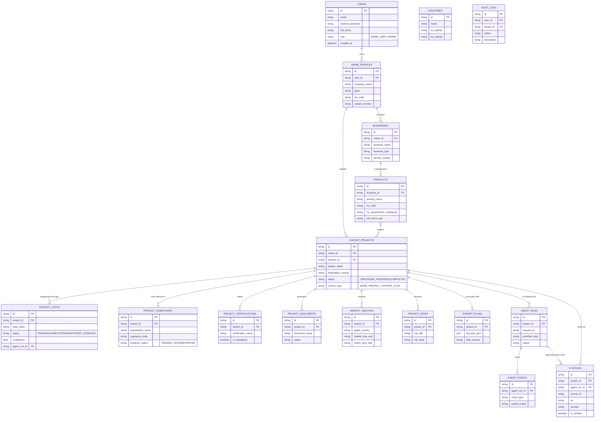

# ExportEase AI - Database Schema

## Overview
The System 3 database is built on PostgreSQL and orchestrates the state of all business logic for the MSME export journey. It strictly stores the results of AI agent runs but does **not** hallucinate regulatory facts, ensuring full preservation of citations mapping back to System 2 (Knowledge/RAG).

## Entity-Relationship Diagram

## Key Architectural Decisions

1. **Source Registry Mapping**: The `CITATIONS` table maps the `source_id` directly retrieved from System 2 (RAG). Any compliance or regulation requirement generated must attach an `.agent_run_id` and trace back to a verifiable citation.
2. **Safety Value Constraints**: Enums across `PROJECT_COMPLIANCE`, `PROJECT_STEPS`, and `DOCUMENT` statuses inherently support an `INSUFFICIENT_EVIDENCE` fallback mechanism. 
3. **Immutability of Audit**: `AUDIT_LOGS` track every business lifecycle mutation asynchronously without slowing down primary transaction writes.
