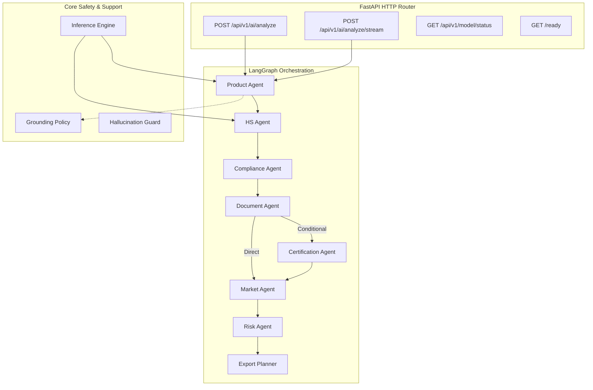

# Final AI Architecture Specification (System 1)

## Overview
This document specifies the final System 1 (AI Intelligence Engine) architecture for the ExportEase system.

## Orchestration Flow & Conditional Routing
1. **Product Agent**: Identifies product and category.
2. **HS Agent**: Classifies HSN taxonomy.
3. **Compliance Agent**: Compares regulatory constraints.
4. **Document Agent**: Resolves mandatory documentation.
5. **Certification Agent**: Runs conditionally if target categories or country laws require special labels (phytosanitary certificates for herbs/honey).
6. **Market Agent**: Compiles market barrier assessments.
7. **Risk Agent**: Computes monetary & geographic risk.
8. **Export Planner**: Aggregates preceding logs into chronological steps.

## Safety & Post-Processing
Each node executes local grounding checks. Output structures are validated against Pydantic definitions and scanned for hallucinations (like ungrounded claims or guessed values) before serialization.
